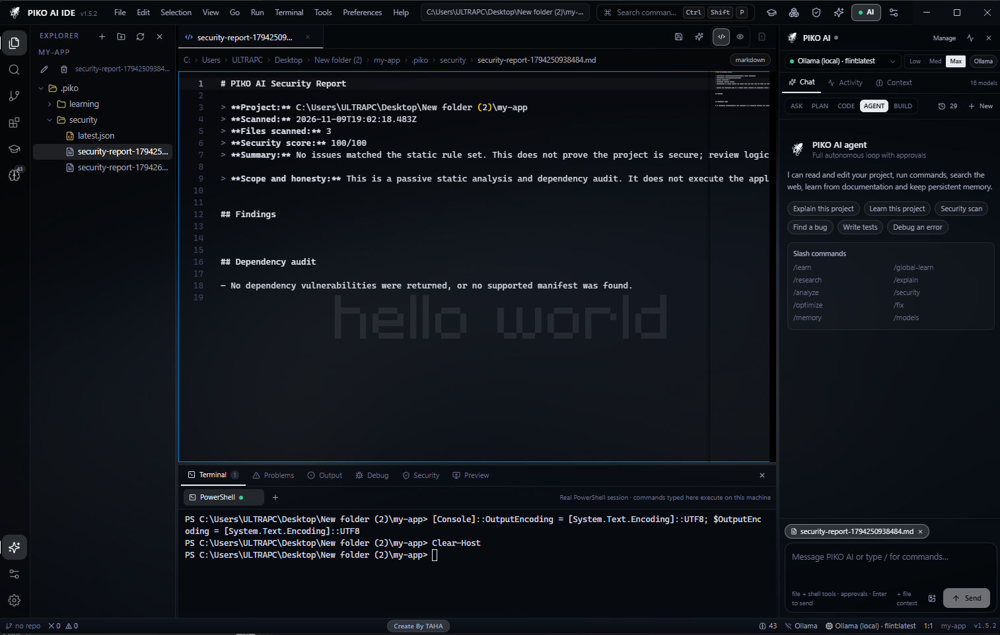
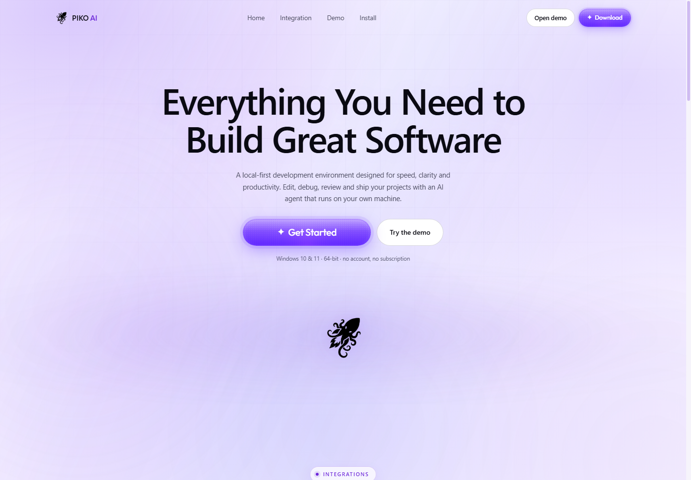

<div align="center">


# PIKO AI

**The AI-native desktop IDE for Windows.**

A real coding agent inside a real IDE — files, terminal, git, web research,
durable memory and defensive security. Local-first, provider-agnostic, no placeholders.

[](https://github.com/black2000a/PIKO-AI-A-APP-DOWNLOAD)
[](#requirements)
[](LICENSE)
[](https://www.electronjs.org/)
[](https://ollama.com)

[Download](https://github.com/black2000a/PIKO-AI-A-APP-DOWNLOAD) · [Features](#features) · [Documentation](#documentation) · [Source](https://github.com/black2000a/Introducing-PIKO-AI-A-Free-AI-Powered-IDE-with-Local-AI-Support) · [Website](https://black2000a.github.io/web-site/)

</div>



<p align="center"><sub>Monaco workspace · agent panel with approvals · real PowerShell terminal · generated security report</sub></p>

---

## Why PIKO AI

Most "AI editors" are a chat box bolted onto a text field. PIKO AI is the other way
round: an IDE built around an agent that can actually do the work — read the project,
edit files, run commands, use git, search the web, remember what it learned and undo
its own mistakes.

- **Real agent, not autocomplete** — five modes, 33 tools, approvals, verification, rollback.
- **Local-first** — the editor, AI panel, workers, themes and wallpapers all work offline.
- **No hard-coded provider** — OpenCode, Ollama, OpenAI, Anthropic, Gemini, OpenRouter, Groq, LM Studio, any OpenAI-compatible endpoint.
- **Learning that persists** — project RAG index plus cited global research, stored in SQLite.
- **Honest behaviour** — when a provider or website fails, PIKO reports the real failure. It never invents sources, files or results.

---

## Table of contents

[Features](#features) · [Wallpapers](#wallpapers--themes) · [Website](#the-website) · [Install](#install) · [Requirements](#requirements) ·
[Quick start](#quick-start-from-source) · [Connect a model](#connect-a-model) · [Ollama](#ollama-local-models) ·
[Agent](#agent-modes) · [Slash commands](#slash-commands) · [Keyboard shortcuts](#keyboard-shortcuts) · [Learning & memory](#learning--memory) ·
[Security](#security) · [Data locations](#data-locations) · [Extensions](#extensions) ·
[AI Builder](#ai-builder) · [Architecture](#architecture) · [Testing](#testing) ·
[Build installers](#build-a-windows-installer) · [Project structure](#project-structure) ·
[Documentation](#documentation) · [Contributing](#contributing) · [License](#license)

---

## Features

| | Feature | What it does |
| --- | --- | --- |
| 🤖 | **Agentic coding** | ASK, PLAN, CODE, AGENT and BUILD modes with file, search, terminal, git and web tools |
| 🛡️ | **Approvals & rollback** | Every write, delete, commit and destructive command is gated and snapshotted |
| 🧠 | **Project learning** | Indexes the workspace into a local vector store and injects relevant context (RAG) into every task |
| 🌍 | **Global learning** | `/global-learn` researches trusted sources and stores cited knowledge for all projects |
| 💾 | **Durable memory** | Separate project and global memory; search, edit, export and import |
| 🔎 | **Web intelligence** | Real search, real page reading, source URLs, `robots.txt` respect and SSRF protection |
| 🧪 | **Self-verification** | Runs checks and tests after edits instead of assuming success |
| 🐞 | **Error tracing** | Lua, Python, JS, Rust, Go and Java traceback parsing with source-aware fixes |
| 🔐 | **Defensive security** | Secrets, injection sinks, OWASP static checks, dependency audit and log analysis |
| 🧩 | **Extensions** | VS Code Marketplace, Open VSX and local `.vsix` — declarative extensions run inside PIKO |
| 🏗️ | **AI Builder** | 27 real project scaffolds: shadcn, Magic UI, Aceternity, Mantine, MUI, Chakra, HeroUI, daisyUI, Nuxt and more |
| 🎨 | **Wallpapers & themes** | 10 original 1920×1080 backgrounds and 4 editor themes |
| 🌐 | **24 languages** | Reply language plus Auto, including Moroccan Darija and Arabic with full RTL |
| ⌨️ | **Keyboard-first** | Copy, cut, paste, rename and delete files from the explorer; paste screenshots into chat |
| ⚡ | **Ollama that works** | Adaptive streaming watchdog, so slow local models do not fail at 120 seconds |
| 📦 | **Offline-capable UI** | Monaco, workers, icons and wallpapers are bundled locally |

---

## Wallpapers & themes

PIKO AI ships ten original 1920×1080 backgrounds, generated for the app and seeded
once into your data folder — deleting one does not bring it back on the next launch.
Four editor themes (Midnight, Obsidian, Aurora, Nebula) restyle the whole workspace.


<p align="center"><sub>aurora-mesh · violet-dunes · neon-grid · glass-orbs · aurora-ribbons · deep-space · mono-topography · sunset-haze · cyber-dots · liquid-chrome</sub></p>

---

## The website

The marketing site lives in `web_site/` — white background, black type and PIKO violet
accents. It ships the real IDE screenshot, a **Download app** button, a **Source code**
link, the **PIKO AI × GitHub × Ollama** strip and the developer message translated into
20 languages with English by default.



---

## Install

Download the latest build from the [**PIKO AI download repository**](https://github.com/black2000a/PIKO-AI-A-APP-DOWNLOAD).

| Build | File | Size | Notes |
| --- | --- | --- | --- |
| Installer | `setup_piko.exe` | ~175 MB | Per-user install, choose folder, desktop + Start menu shortcuts |
| Portable | `PIKO-AI-Portable-1.5.3-x64.exe` | ~150 MB | Single executable, no installation |

Both builds write data to `%APPDATA%\PIKO AI`. Uninstalling keeps your memory and
settings by default.

> **SmartScreen:** builds are not code-signed, so Windows may warn on first launch.
> Choose **More info → Run anyway**, or sign your own build with `CSC_LINK` and
> `CSC_KEY_PASSWORD` (see [Build a Windows installer](#build-a-windows-installer)).

### Requirements

- Windows 10 or Windows 11, **x64**
- 4 GB RAM minimum — 8 GB or more recommended for local models
- Internet only for cloud providers and web research
- Optional: Git on `PATH` for source control
- Optional: [Ollama](https://ollama.com) or an OpenCode server for local models

### First run

1. **File → Open Folder** and pick a project.
2. Open **Model Manager** (`Ctrl+Shift+M`) and configure one provider.
3. Select a model in the AI panel.
4. Start in **ASK** mode, then grant write access when you are comfortable.

---

## Quick start from source

Requirements: Node.js 20+ (Node 24 tested), npm 10+, Git, Windows 10/11 x64.

```powershell
git clone https://github.com/black2000a/Introducing-PIKO-AI-A-Free-AI-Powered-IDE-with-Local-AI-Support.git piko-ai
cd piko-ai
npm install
npm run build
npm start
```

Live development with hot reload:

```powershell
npm run dev
```

The renderer runs on `http://localhost:5199`; Electron starts after Vite is ready.

---

## Connect a model

Open **Model Manager** (`Ctrl+Shift+M`) and choose any of these paths — PIKO AI ships
no hard-coded provider.

| Provider | Setup |
| --- | --- |
| **OpenCode** (preferred) | Start a local OpenCode server on `http://127.0.0.1:4096`, then refresh models |
| **Ollama** | `ollama serve`, pull a coding model, then select it |
| **OpenAI** | Add an API key |
| **Anthropic** | Add an API key |
| **Google Gemini** | Add an API key |
| **OpenAI-compatible** | OpenRouter, Groq, LM Studio or any custom base URL |

API keys are encrypted with OS secure storage (DPAPI on Windows), never written to
logs and never sent to the renderer.

### Ollama (local models)

```powershell
ollama serve
ollama pull qwen2.5-coder
```

Then pick **Ollama (local)** in the model selector and refresh.

Local models are slow on the first token, so PIKO AI does not use a fixed 120-second
timeout:

- first byte: **480 s**
- idle between chunks: **300 s**
- scaled ×1.6 on medium, ×2.5 on low, ×1 on max power mode
- the timer resets on every chunk received
- a real failure returns a 504 with concrete recovery steps, not a false timeout

---

## Agent modes

| Mode | Behaviour |
| --- | --- |
| `ASK` | Read-only answers and explanations |
| `PLAN` | Produces a plan; no writes without approval |
| `CODE` | Edits files with diffs and verification |
| `AGENT` | Autonomous multi-step tool loop until the task is done |
| `BUILD` | Scaffolds a project through the AI Builder kits |

### Agent tools (33)

| Group | Tools |
| --- | --- |
| Files | `read_file` `list_files` `search_files` `find_file` `write_file` `edit_file` `create_folder` `move_file` `delete_file` |
| Execution | `run_command` `run_checks` `trace_error` `take_screenshot` `describe_image` |
| Media | `create_image` `create_logo` `create_icon_set` |
| Web | `web_search` `read_url` `read_github_repo` |
| Knowledge | `memory_search` `memory_save` `index_project` `analyze_project` |
| Git | `git_status` `git_diff` `git_commit` `git_branches` |
| Security | `security_scan` `analyze_logs` `undo_changes` |
| Orchestration | `spawn_subagent` `subagent_result` |

Every mutating step passes the approval layer and is snapshotted for undo.

---

## Slash commands

Type them in the AI panel or the command palette.

| Command | Purpose |
| --- | --- |
| `/learn <URL>` | Learn design system, UI/UX and technology from a website |
| `/learn github <URL>` | Learn from a GitHub repository |
| `/learn docs <URL>` | Learn from a documentation page |
| `/learn project` | Index and learn the current workspace |
| `/learn file <PATH>` | Learn a single project file |
| `/global-learn <TOPIC>` | Research a topic into cited global knowledge |
| `/research <TOPIC>` | Search and read real sources with links |
| `/explain <FILE>` | Explain a file, function or selection |
| `/analyze` | Analyse architecture, technologies and risks |
| `/security` | Run the defensive security scan |
| `/optimize [AREA]` | Find performance and maintainability improvements |
| `/fix <ERROR>` | Diagnose and apply a verified fix |
| `/memory` | Show memory counts |
| `/memory search <QUERY>` | Search project and global memory |
| `/memory clear [scope]` | Clear project, global or all memory |
| `/memory export` / `/memory import` | Export or import memory JSON |
| `/models` | List available providers and models |
| `/index` | Re-index the project for RAG |
| `/terminal <COMMAND>` | Run a real shell command |
| `/help` | List every command |

Comment commands work inside source files too — `// @ai explain this function`,
`# @ai optimize this loop`. Ordinary comments are never modified.

---

## Keyboard shortcuts

### Explorer

Click a file or folder once to select it, then work without the mouse.

| Shortcut | Action |
| --- | --- |
| `Ctrl+C` | Copy the selected file or folder |
| `Ctrl+X` | Cut the selected file or folder |
| `Ctrl+V` | Paste into the selected folder (or next to the selected file) |
| `Delete` | Arm the delete confirmation — press `Delete` again to remove |
| `F2` | Rename the selected item |
| `Esc` | Cancel rename or delete confirmation |

Copies never overwrite: pasting twice produces `style copy.css`, then `style copy 2.css`.
The explorer shows a clipboard strip with the copied name and `Ctrl+V` hint.

Rename with a click: hover a file and press the small pencil that appears, or click the
pencil in the explorer toolbar. The name is edited in place with the extension left out
of the selection — `Enter` (or clicking away) keeps it, `Esc` cancels. `F2` does the same
from the keyboard.

### AI chat

| Shortcut | Action |
| --- | --- |
| `Enter` | Send the message |
| `Shift+Enter` | New line without sending |
| `Ctrl+V` | Paste a screenshot straight from the clipboard into the message |
| `/` | Open the command list |
| `↑` `↓` + `Tab` | Move through command suggestions and insert one |

Paste screenshots with `Win+Shift+S` → `Ctrl+V` in the chat box. Up to four images are
attached per message and sent to the selected vision-capable model.

### Workspace

| Shortcut | Action |
| --- | --- |
| `Ctrl+Shift+P` | Command palette |
| `Ctrl+N` | New text file |
| `Ctrl+Shift+E` | Explorer |
| `Ctrl+Shift+F` | Search |
| `Ctrl+Shift+G` | Source control |
| `Ctrl+Shift+X` | Extensions |
| `Ctrl+Shift+M` | Model manager |
| `Ctrl+,` | Settings |
| `Ctrl+S` | Save file |
| `Ctrl+B` | Toggle the AI panel |
| `Ctrl+J` | Toggle the bottom panel |
| `Ctrl+W` | Close the active tab |
| `Ctrl+=` / `Ctrl+-` / `Ctrl+0` | Zoom in / out / reset |
| `Alt+Z` | Toggle word wrap |

---

## Learning & memory

- **Project learning** — the workspace is indexed into a local semantic vector store;
  retrieved chunks are injected into each task.
- **Global learning** — `/global-learn` researches trusted public sources, stores
  citations and clearly labels verified facts, assumptions and possibly outdated knowledge.
- **Deep Learning marathons** — one-off topics or 6 / 12 / 24 / 100-hour domain
  sessions that keep researching, pause, resume and survive restarts.
- **Durable memory** — project and global memory are separate stores that can be
  searched, edited, exported and imported.
- **Continuous chat** — follow-ups keep the visible transcript; context is condensed
  automatically so long sessions stay inside the model window.

---

## Security

PIKO AI is a defensive tool. It audits your code; it does not attack anything.

- Secrets detection and redaction in logs and reports
- Injection sinks and unsafe-pattern checks
- OWASP-oriented static review, dependency audit, log and configuration analysis
- Approval gate before writes, deletes, commits and destructive shell commands
- SSRF guard on every outbound URL — no private ranges, no cloud metadata endpoints
- `robots.txt` respected when reading the web
- File snapshots and revisions before every mutation, with undo and rollback
- Sandboxed renderer, context isolation and a typed preload bridge
- Local-first: no telemetry upload

Read the full [security model](docs/SECURITY.md).

---

## Data locations

Everything lives under `%APPDATA%\PIKO AI`:

| Path | Contents |
| --- | --- |
| `piko.db` | Settings, secrets, projects, memory, learning, tasks, chat, operations, security reports |
| `backups/` | File snapshots used by undo and rollback |
| `learning/` | Learning reports and screenshots |
| `logs/` | Application, AI, tool and security logs |
| `cache/` | Temporary downloads |
| `wallpapers/` | Seeded built-in backgrounds and `.piko-seeded.json` |

Open **File → Open Data Folder** in the app to reach them.

---

## Extensions

- Search and install from the **Microsoft VS Code Marketplace**, **Open VSX**, or a local `.vsix`
- Declarative extensions — themes, snippets, languages — run inside PIKO
- Code-only extensions are clearly flagged, with a one-click path into a real VS Code
  using the `code` CLI
- Companion extension included: `extensions/piko-sidebar` (packaged as `piko-sidebar-1.0.0.vsix`)

---

## AI Builder

Generate a real project, not a placeholder. 27 kits, each producing runnable files:

`web-app` · `website` · `desktop-app` · `api` · `mobile-app` · `automation` ·
`react-vite` · `nextjs` · `static` · `vue-vite` · `react-shadcn` · `next-shadcn` ·
`react-magicui` · `next-magicui` · `react-aceternity` · `react-mantine` · `react-mui` ·
`react-chakra` · `react-heroui` · `react-daisyui` · `next-flowbite` · `vue-nuxt` ·
`svelte-skeleton` · `node-api` · `electron` · `expo` · `python`

---

## Architecture

```text
main process (Electron)                     renderer (React + Monaco)
├── main.ts         lifecycle, windows     ├── components/   IDE surface, panels, modals
├── ipc.ts          typed IPC surface      ├── store/        Zustand application state
├── db.ts           SQLite (sql.js)        ├── lib/          themes, helpers, clients
├── settings.ts     settings + secrets     └── shared/       types, API contract, languages
├── commands.ts     slash-command engine
├── ai/
│   ├── providers.ts    provider adapters + streaming watchdog
│   ├── agent.ts        tool loop, approvals, verification
│   ├── tools.ts        33 agent tools
│   ├── opencode.ts     local OpenCode client
│   ├── condenser.ts    context compression
│   ├── aider.ts        edit strategy
│   ├── stuck.ts        loop detection
│   ├── language.ts     reply-language policy
│   └── subagents.ts    parallel agent sessions
├── services/       29 focused services (files, git, memory, web, security, …)
└── security/urlGuard.ts   SSRF policy
```

### Tech stack

| Layer | Technology |
| --- | --- |
| Shell | Electron 45 |
| UI | React 18, TypeScript 5.7, Tailwind CSS 3.4 |
| Editor | Monaco 0.52 |
| Terminal | xterm.js 5.5 |
| State | Zustand 5 |
| Storage | SQLite via sql.js (WASM) |
| Build | Vite 6, esbuild, electron-builder 26 |
| Parsing / rendering | Cheerio, marked, DOMPurify, diff, semver |
| Updates | electron-updater |

| Layer | Files | Lines |
| --- | --- | --- |
| Renderer (`src/`) | 40 | ~14,400 |
| Main process (`electron/`) | 52 | ~17,900 |

---

## Testing

```powershell
npm run typecheck      # renderer + main process TypeScript
npm run build          # main process + renderer
npm run test:core      # deterministic core suite in a real Electron process
npm run ui-smoke       # launch the real renderer hidden and verify the UI
```

| Suite | Checks | Covers |
| --- | --- | --- |
| `test:core` | 54 | SQLite persistence, settings, file operations, git, RAG indexing, memory, security, learning, undo/rollback, SSRF, terminal, mock provider, full agent tool loop |
| `ui-smoke` | 25 | Renderer boot, key surfaces, explorer keyboard flow (Ctrl+C / Ctrl+V / Delete) and click-to-rename in the real app |

---

## Build a Windows installer

```powershell
npm run dist
```

Artifacts are written to `release/`:

- `setup_piko.exe` — NSIS installer (wizard, install folder, shortcuts)
- `PIKO-AI-Portable-1.5.3-x64.exe` — portable executable
- `latest.yml`, `setup_piko.exe.blockmap` — update metadata

Auto-update uses a generic provider at `https://updates.piko.ai/desktop`.
Unsigned builds may show a SmartScreen warning; signing uses `CSC_LINK` and
`CSC_KEY_PASSWORD`.

---

## Project structure

```text
build/            installer icons and build resources
docs/             install, development, configuration, security, overview
electron/         main process, AI engine, services, security
extensions/       piko-sidebar VS Code companion extension
public/           static renderer assets
scripts/          build, icon, wallpaper, screenshot and test scripts
src/              React renderer
wallpaper/        ten 1920×1080 backgrounds
web_site/         marketing site and downloads
```

---

## Documentation

| Document | Contents |
| --- | --- |
| [Install guide](docs/INSTALL.md) | Installer, portable build, first run, troubleshooting |
| [Development guide](docs/DEVELOPMENT.md) | Architecture, conventions, dev loop |
| [Configuration](docs/CONFIGURATION.md) | Every setting and provider |
| [Security model](docs/SECURITY.md) | Threat model and protections |
| [Complete overview](docs/PIKO-OVERVIEW.md) | Everything about PIKO AI in one document |

---

## Contributing

Issues and pull requests are welcome.

1. Fork the repository and create a branch.
2. Keep the existing structure, naming and style.
3. Run `npm run typecheck`, `npm run test:core` and `npm run ui-smoke`.
4. Describe what changed and why — with real reproduction steps.

No placeholders, no fake data, no invented results. That rule applies to code,
tests and documentation alike.

---

## License

[MIT](LICENSE) © 2026 PIKO AI

---

<div align="center">

**Built by TAHA — BLACK2DEV**

<sub>Discord taha29dev · tahazitoni123@gmail.com</sub>

<sub>PIKO AI × GitHub × Ollama</sub>

</div>
